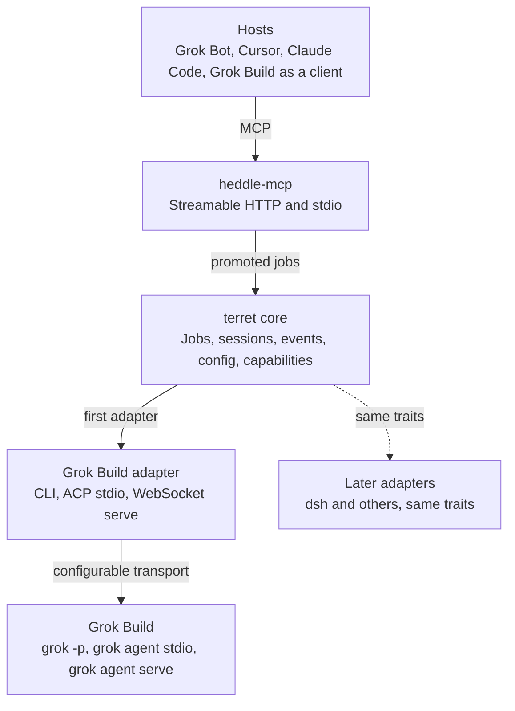

# Terret design

Terret is a public early-effect Scala library that lets coding hosts talk to coding harnesses: MCP in, adapters out, with Grok Build first. This document records the north star, the phases agreed on 6 November 2026, and the build and docs decision added on 9 November 2026: histos builds and ships it, specular documents it.

## Name

Terret is named for the rings on a harness that the reins pass through. It is the guide between a driver and a horse, the way a heddle is a guide on a loom: not the host, and not the harness.

It is a new public open-source early-effect project, written in Scala 3, standards-based, and customizable to a user's workflow. The first user is Russ, but the library is for everyone.

## North star

**MCP in, harness adapters out.** Hosts such as Grok Bot, Cursor, and Claude Code attach over MCP. Coding harnesses such as Grok Build attach through adapters. The core stays harness-agnostic. MCP and ACP matter, and they land in phases rather than on day one.

Do not grow a second tool DSL beside heddle. HTTP, OpenAPI, MCP Streamable HTTP, and stdio are hosts of one capability bind. Terret adds the missing outbound edge: talking to a coding harness through an adapter, then promoting coarse jobs through heddle so those hosts can call them.

## Architecture

The first runnable speaks both MCP stdio and local Streamable HTTP. Config chooses how it listens. HTTP is the focus, because that is how hosts attach. Both must work.

## Locked decisions

| Decision | Value |
| --- | --- |
| Audience | Public, open source, standards-based; customizable to the principal user's workflow |
| Shape | Harness-agnostic Scala core first; Grok Build is the first live adapter |
| Inbound | MCP stdio and Streamable HTTP, via heddle-mcp, HTTP first |
| Outbound | Adapter transports the user configures, not a single hardcoded path |
| Heddle | Depend on it; file enhancement issues for shared gaps; do not fork the protocol stack |
| Catalog | Richer job set as the goal; ship a subset and grow through adapter capabilities |
| Permissions | User-configured gating; a ceiling that clamps is the built-in mechanism |
| Build | histos builds, tests, and ships terret, like the other early-effect libraries |
| Docs | specular, through its histos plugin, owns the comprehensive docs and the docs site; the README stays high-level |
| Versions | No version number is written by hand in docs; say "latest stable". Specular derives the shipped version from the build, and the install version follows the ship |

## Phases

| Phase | What ships | What it proves |
| --- | --- | --- |
| 1. Core | Library with no network and no Grok required: harness, session, prompt, streamed events, workspace, capability traits, and config | Tests against a fake in-memory harness; customization hooks live here |
| 2. Grok Build adapter | One adapter with three configurable transports: `grok -p` / `--prompt-file`, ACP stdio (`grok agent stdio`), and WebSocket ACP (`grok agent serve`) | The adapter contract against a real harness; the user picks the transport |
| 3. MCP inbound | A heddle `Api` whose jobs `Mcp.from` serves on `mcp.routes` and `mcp.stdio()` | Hosts can attach without grok-specific tool names leaking through |
| 4. Packaging | A runnable process, Warp.local defaults, and the specular docs site with attach guides for other hosts | Config picks HTTP or stdio; HTTP is the documented attach path, and every snippet on the docs site is proven by the build |
| 5. More adapters | dsh and later harnesses implement the same traits | The MCP jobs do not change |

Phase 2 is not a CLI-then-ACP sequence. All three Grok Build transports ship in that adapter phase, behind one hook, so a user can pick one, switch, or set defaults.

## Catalog

The goal is a richer catalog than a handful of verbs, including inspect, list, status, and harness knobs, exposed through modular adapter capabilities. Knobs must not appear as Grok-specific tool names.

The first ship implements a subset we can prove. Run, resume, export, and cancel are the natural start. More jobs appear when an adapter actually supports them. This document is where the intended catalog stays visible so incremental work does not shrink the goal.

| Job | First ship | Goal |
| --- | --- | --- |
| run / prompt | Yes | Yes |
| resume | Yes | Yes |
| export | Yes | Yes |
| cancel | Yes | Yes |
| inspect, list, status | When the adapter can prove them | Yes |
| Further harness knobs | As capability traits land | Yes |

Follow heddle's authoring rule: the tool is the job. Promote coarse operations agents should call. Keep transport, inspect details, and fine harness steps as config, HTTP resources, or later read-only tools, not a pile of internal steps.

## Permissions and config

Terret is a configurable connector. Users dictate how access is gated. The library must not pick a single policy for everyone.

The built-in mechanism is a config ceiling that clamps the harness. Config can also inherit the harness settings, or later ask the host if that capability exists. If nothing is set, fail closed with a conservative ceiling the user can loosen.

The same rule applies to transports and listeners: offer stdio and HTTP, CLI and ACP, and let config pick. Do not hardcode one true sandbox or one true wire.

## Heddle

Heddle already is the MCP inbound layer. `Mcp.from` turns promoted operations into tools. The same server speaks Streamable HTTP at `/mcp` (sessions, SSE when requested, native MCP 2026-07-28 with 2025-11-25 `initialize` so Grok Build, Cursor, and Claude Code can attach) and newline-delimited JSON-RPC on stdio. It also has matching clients, `Session.publish`, cancel, and optional bearer metadata. MCP Apps sit on top and are extra for terret's first phases.

Terret depends on `heddle-mcp` rather than inventing another stack. When a needed capability belongs in heddle, file an enhancement issue on early-effect/heddle and pick it up later. Do not fold Grok Build or ACP into heddle. ACP, `grok -p`, and other harness wires live in terret. A heddle WebSocket client is already listed as later on heddle's roadmap; that is an example of an issue to file if we want to reuse it instead of implementing ACP-over-WebSocket only in terret.

`LinePipe` and heddle's JSON-RPC stdio work are good primitives to reuse when implementing ACP stdio, without making heddle speak ACP.

## Grok Build adapter

| Transport | Command | Role |
| --- | --- | --- |
| CLI | `grok -p` and `--prompt-file`, plus sessions and export | Headless prompt path |
| ACP stdio | `grok agent stdio` | JSON-RPC over a pipe: initialize, authenticate, session/new, session/prompt, streamed session/update |
| ACP WebSocket | `grok agent serve` | The same ACP session model on localhost |

The user picks the transport in config. The adapter should not hide one behind another. `grok mcp` is Grok Build consuming MCP servers, not exposing itself as MCP; terret is the other direction.

## Build and docs

Terret uses two early-effect tools together. histos is the build: it compiles, tests, publishes, and generates the CI. specular is the documentation: it now ships a histos plugin, so the docs build and the docs tests run inside the same `./histos` workflow as the library.

| Surface | Job | Owner |
| --- | --- | --- |
| README | High-level: what terret is, why it exists, a short path to attach a host, and links into the docs site | Hand-written, kept short |
| Docs site | Comprehensive: concepts, config keys, every transport, the permission ceiling, each adapter, the job catalog, and attach guides per host | specular DocSpecs, built and tested by histos |
| Design doc | Decisions and the north star while the project is being shaped | This file, until the docs site covers it |

A documentation page that can lie should fail the build. Each page is a real Scala program that asserts under the test run and then renders to the site, so a snippet that does not compile or does not hold fails CI, as it does for the other early-effect libraries.

> **No hardcoded versions.** Specular derives the shipped version from the build, so neither the README nor the docs site carries a version number typed by hand. Where a version must be named, say "latest stable". The install version follows the ship: when a release is cut, the coordinate shown in the docs is the one that shipped, with no docs edit and no drift.

That rule matters most for terret, because hosts are configured with a command or a URL and a version. A stale number in an attach guide is a broken setup for a user. The docs site is the one place a host configuration is allowed to name a version, and it takes that version from the ship.

Specular also writes a manifest beside each site, so terret's docs can appear as a card on the early-effect hub with the same version the release carries. Docs are published with the release rather than on a separate schedule.

## Decided names

The first jobs are `run`, `resume`, `export`, and `cancel`. `run` sends a prompt. `resume` replays the retained log and does not send a prompt. `export` returns that log. `cancel` interrupts the open turn. The Scala method for that job is `transcript`, because `export` is a Scala 3 keyword. The job name stays `export`.

Permissions are `ReadWorkspace`, `WriteWorkspace`, `RunCommands`, and `Network`. `PermissionPolicy` is `Closed`, `Clamp`, or `Inherit`. Nothing set is `Closed`, which caps a session at `ReadWorkspace`. A request is intersected with that cap, and the session records what was dropped. A workspace outside the configured root is rejected.

`TerretConfig` carries the policy and an optional workspace root. Listener and adapter transport are not part of it. An unset root means the opened workspace is its own root. The packaged process will require a root.

`Harness.open` takes the workspace, the requested ceiling, and the policy. Terret passes `config.policy`. The harness clamps the request against that policy's ceiling and records the ceiling that was applied.

`GrokConfig` is the adapter's own config: the command, the transport (`Cli`, `AcpStdio`, or `AcpWebSocket`), the approval (`Ask` or `Always`), and an optional bind (host, port, secret) for the socket transport. An empty command, host, or secret is rejected, and a port outside 1 to 65535 is rejected. `Ask` is the default. `Always` is opt-in: it passes `--always-approve` and, on ACP `session/new`, sets `_meta.yoloMode`. It does not pass `--permission-mode`. A socket transport with no bind fails open with `BindMissing`. Terret connects to a serve the user already started. It does not spawn `grok agent serve`.

`Inherit` passes neither a permission mode nor a deny list. `Closed` and `Clamp` pass `--permission-mode default` when approval is `Ask`, and one `--disallowed-tools` list for the tools the effective ceiling does not allow. No `ReadWorkspace` denies `grep`, `list_dir`, and `read_file`. No `WriteWorkspace` denies `search_replace` and `write`. No `RunCommands` denies `run_terminal_cmd`. No `Network` denies `web_fetch` and `web_search`. The flag is omitted when nothing is denied.

The CLI transport mints the session id. The first prompt uses `-s`. A later prompt uses `-r`. Resume replays the retained structured events and does not spawn, and it does not parse `grok export` markdown. The ACP transports adopt the agent's session id. `session/load` runs only when that retained log is empty. A `session/request_permission` is answered from the ceiling: `Inherit` allows, and an unknown kind under a partial ceiling is denied. A refusal stop is `Refused`. An end line decides the turn, so the process exit code is not a second failure.

Heddle speaks the WebSocket upgrade on the server and newline JSON-RPC on stdio. It does not ship a WebSocket client, so the socket transport uses the JDK client. ACP stdio reuses `LinePipe`. Neither wire is folded into heddle as ACP.

## Later

dsh and any later harness implement the same core traits. Their protocols are not specified here yet. The MCP jobs should not change when a new adapter lands.

Packaging on Warp.local, histos catalog shipping, and a published process come after the core and first adapter feel honest. Docs follow early-effect practice, as set out in Build and docs: proven snippets on a specular site, not a second story beside the code. Exact job names, config keys, and the first heddle enhancement issues can be added to this document as they are decided, and move to the docs site once it exists.

## Sources

- [Heddle docs](https://www.earlyeffect.rocks/heddle/)
- [One capability, many hosts](https://www.earlyeffect.rocks/heddle/one-capability-many-hosts.html)
- [The tool is the job](https://www.earlyeffect.rocks/heddle/the-tool-is-the-job.html)
- [Agents](https://www.earlyeffect.rocks/heddle/agents.html)
- [Agents fall out](https://www.earlyeffect.rocks/heddle/agents-fall-out.html)
- [heddle repository](https://github.com/early-effect/heddle)
- [Why Specular](https://www.earlyeffect.rocks/specular/)
- [specular repository](https://github.com/early-effect/specular)
