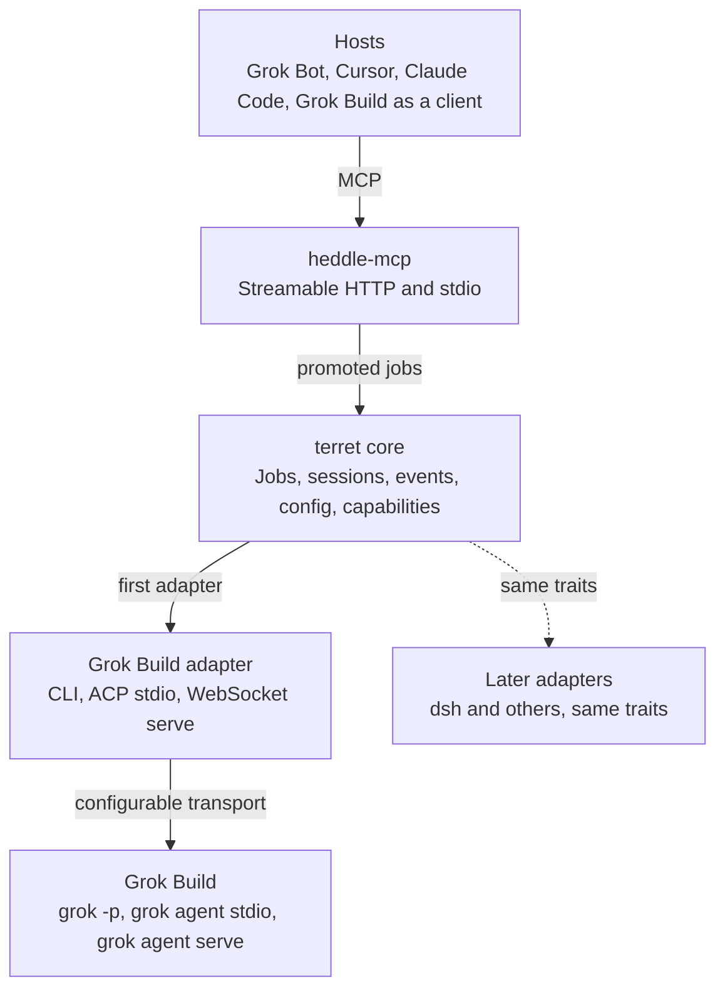

# Terret design

Terret is a public early-effect Scala library that lets coding hosts talk to coding harnesses: MCP in, adapters out, with Grok Build first. This document records the north star, the phases agreed on 6 November 2026, and the build and docs decision added on 9 November 2026: histos builds and ships it, specular documents it.

## Name

Terret is named for the rings on a harness that the reins pass through. It is the guide between a driver and a horse, the way a heddle is a guide on a loom: not the host, and not the harness.

It is a new public open-source early-effect project, written in Scala 3, standards-based, and customizable to a user's workflow. The first user is Russ, but the library is for everyone.

## North star

**MCP in, harness adapters out.** Hosts such as Grok Bot, Cursor, and Claude Code attach over MCP. Coding harnesses such as Grok Build attach through adapters. The core stays harness-agnostic. MCP and ACP matter, and they land in phases rather than on day one.

Do not grow a second tool DSL beside heddle. HTTP, OpenAPI, MCP Streamable HTTP, and stdio are hosts of one capability bind. Terret adds the missing outbound edge: talking to a coding harness through an adapter, then promoting coarse jobs through heddle so those hosts can call them.

## Architecture

The first runnable speaks both MCP stdio and local Streamable HTTP. Config chooses how it listens. HTTP is the focus, because that is how hosts attach. Both must work.

## Locked decisions

| Decision | Value |
| --- | --- |
| Audience | Public, open source, standards-based; customizable to the principal user's workflow |
| Shape | Harness-agnostic Scala core first; Grok Build is the first live adapter |
| Inbound | MCP stdio and Streamable HTTP, via heddle-mcp, HTTP first |
| Outbound | Adapter transports the user configures, not a single hardcoded path |
| Heddle | Depend on it; file enhancement issues for shared gaps; do not fork the protocol stack |
| Catalog | Richer job set as the goal; ship a subset and grow through adapter capabilities |
| Permissions | User-configured gating; a ceiling that clamps is the built-in mechanism |
| Build | histos builds, tests, and ships terret, like the other early-effect libraries |
| Docs | specular, through its histos plugin, owns the comprehensive docs and the docs site; the README stays high-level |
| Versions | No version number is written by hand in docs; say "latest stable". Specular derives the shipped version from the build, and the install version follows the ship |

## Phases

| Phase | What ships | What it proves |
| --- | --- | --- |
| 1. Core | Library with no network and no Grok required: harness, session, prompt, streamed events, workspace, capability traits, and config | Tests against a fake in-memory harness; customization hooks live here |
| 2. Grok Build adapter | One adapter with three configurable transports: `grok -p` / `--prompt-file`, ACP stdio (`grok agent stdio`), and WebSocket ACP (`grok agent serve`) | The adapter contract against a real harness; the user picks the transport |
| 3. MCP inbound | A heddle `Api` whose jobs `Mcp.from` serves on `mcp.routes` and `mcp.stdio()` | Hosts can attach without grok-specific tool names leaking through |
| 4. Packaging | A runnable process, Warp's `.warp/.mcp.json`, and specular docs pages | Config picks HTTP or stdio; HTTP is the documented attach path, and every snippet is proven by the build. The catalog names specular-histos and the build turns the site service on |
| 5. More adapters | dsh and later harnesses implement the same traits | The MCP jobs do not change |

Phase 2 is not a CLI-then-ACP sequence. All three Grok Build transports ship in that adapter phase, behind one hook, so a user can pick one, switch, or set defaults.

## Catalog

The goal is a richer catalog than a handful of verbs, including inspect, list, status, and harness knobs, exposed through modular adapter capabilities. Knobs must not appear as Grok-specific tool names.

The first ship is `open`, `run`, `status`, `resume`, `export`, and `cancel`. `run` returns when the turn is accepted. `status` is how a host waits for the outcome. More jobs appear when an adapter actually supports them. This document is where the intended catalog stays visible so incremental work does not shrink the goal.

| Job | First ship | Goal |
| --- | --- | --- |
| run / prompt | Yes | Yes |
| status | Yes | Yes |
| resume | Yes | Yes |
| export | Yes | Yes |
| cancel | Yes | Yes |
| inspect, list | When the adapter can prove them | Yes |
| Further harness knobs | As capability traits land | Yes |

Follow heddle's authoring rule: the tool is the job. Promote coarse operations agents should call. Keep transport, inspect details, and fine harness steps as config, HTTP resources, or later read-only tools, not a pile of internal steps.

## Permissions and config

Terret is a configurable connector. Users dictate how access is gated. The library must not pick a single policy for everyone.

The built-in mechanism is a config ceiling that clamps the harness. Config can also inherit the harness settings, or later ask the host if that capability exists. If nothing is set, fail closed with a conservative ceiling the user can loosen.

The same rule applies to transports and listeners: offer stdio and HTTP, CLI and ACP, and let config pick. Do not hardcode one true sandbox or one true wire.

## Heddle

Heddle already is the MCP inbound layer. `Mcp.from` turns promoted operations into tools. The same server speaks Streamable HTTP at `/mcp` (sessions, SSE when requested, native MCP 2026-07-28 with 2025-11-25 `initialize` so Grok Build, Cursor, and Claude Code can attach) and newline-delimited JSON-RPC on stdio. It also has matching clients, `Session.publish`, cancel, and optional bearer metadata. MCP Apps sit on top and are extra for terret's first phases.

Terret depends on `heddle-mcp` rather than inventing another stack. When a needed capability belongs in heddle, file an enhancement issue on early-effect/heddle and pick it up later. Do not fold Grok Build or ACP into heddle. ACP, `grok -p`, and other harness wires live in terret. A heddle WebSocket client is already listed as later on heddle's roadmap; that is an example of an issue to file if we want to reuse it instead of implementing ACP-over-WebSocket only in terret.

`LinePipe` and heddle's JSON-RPC stdio work are good primitives to reuse when implementing ACP stdio, without making heddle speak ACP.

## Grok Build adapter

| Transport | Command | Role |
| --- | --- | --- |
| CLI | `grok -p` and `--prompt-file`, plus sessions and export | Headless prompt path |
| ACP stdio | `grok agent stdio` | JSON-RPC over a pipe: initialize, authenticate, session/new (including mcpServers), session/load, session/prompt, streamed session/update |
| ACP WebSocket | `grok agent serve` | The same ACP session model on localhost |

The user picks the transport in config. The adapter should not hide one behind another. `grok mcp` is Grok Build consuming MCP servers, not exposing itself as MCP; terret is the other direction.

## Dsh adapter

The dsh adapter speaks the headless profile's `--json` projection. One invocation answers one task and exits. The command is `dsh --profile headless --json`, and the task is one positional argument. The working directory is the opened workspace.

The CLI mints a fresh session id and reports it on the opening `session` event (`sessionId`, `cwd`). The adapter keeps that id and passes `--session-id` on the next prompt. A fresh prompt omits `--session-id`: an id with no stored session fails before the task runs. Resume replays the retained log and does not spawn. A lone `-` is the CLI's stdin marker, so the adapter rejects that prompt instead of writing stdin.

Stdout is newline-delimited JSON. `text` becomes an assistant event. `thinking` becomes a thought. `tool_call` (`callId`, `tool`, `input`) starts a tool. `tool_result` (`callId`, `status`, `result`) updates it. `status` lines with phase `turn_start`, `step_start`, `step_end`, or any other phase are progress. `turn_end` carries `reason.kind`: `completed` finishes the turn, `aborted` cancels it, `blocked` is a refusal, and `error`, `max-tokens`, `interrupted`, `forked`, and any other kind fail the turn. The `error` object's message is not control. An `error` event (`message`) fails the turn the same way and ends the stream without `final`. `final` (`text`) is the runner's uncapped answer and does not add a second assistant event. Unknown event types are skipped. A non-JSON line is malformed.

A `turn_end` or an `error` event decides the turn, so the process exit code is not a second failure. Exit 0 with neither is incomplete. A non-zero exit with neither is that exit code. Headless exits 0 only when the last reason kind is `completed`.

Headless has no permission flag. The adapter records the ceiling it was given and does not invent a deny list. The core still clamps before `open`. The packaged process defaults to Grok. `harness` `dsh` selects this adapter. The MCP jobs do not change.

## Build and docs

Terret uses two early-effect tools together. histos is the build: it compiles, tests, publishes, and generates the CI. specular is the documentation: it now ships a histos plugin, so the docs build and the docs tests run inside the same `./histos` workflow as the library.

| Surface | Job | Owner |
| --- | --- | --- |
| README | High-level: what terret is, why it exists, a short path to attach a host, and links into the docs site | Hand-written, kept short |
| Docs site | Comprehensive: concepts, config keys, every transport, the permission ceiling, each adapter, the job catalog, and attach guides per host | specular DocSpecs, built and tested by histos |
| Design doc | Decisions and the north star while the project is being shaped | This file, until the docs site covers it |

A documentation page that can lie should fail the build. Each page is a real Scala program that asserts under the test run and then renders to the site, so a snippet that does not compile or does not hold fails CI, as it does for the other early-effect libraries.

> **No hardcoded versions.** Specular derives the shipped version from the build, so neither the README nor the docs site carries a version number typed by hand. Where a version must be named, say "latest stable". The install version follows the ship: when a release is cut, the coordinate shown in the docs is the one that shipped, with no docs edit and no drift.

That rule matters most for terret, because hosts are configured with a command or a URL and a version. A stale number in an attach guide is a broken setup for a user. The docs site is the one place a host configuration is allowed to name a version, and it takes that version from the ship.

Specular also writes a manifest beside each site, so terret's docs can appear as a card on the early-effect hub with the same version the release carries. Docs are published with the release rather than on a separate schedule.

## Decided names

The first jobs are `open`, `run`, `status`, `resume`, `export`, and `cancel`. `run` accepts a prompt and returns while the turn is running. `status` returns the session state, and the outcome once the turn has ended. `resume` replays the retained log and does not send a prompt. `export` returns that log. `cancel` is the only stop. The Scala method for export is `transcript`, because `export` is a Scala 3 keyword. The job name stays `export`.

Each retained event has a stable index, starting at 0, the turn epoch marked for the session, and the time it was appended. `export` takes optional `after`, `milestones`, and `latest`. `after` is exclusive. `milestones` keeps only the events the shared milestone classifier accepts. A tool start is not one, and a test line is not one. The classifier reports a turn, a commit, a push, a pull-request state, an error, or a wait on `ask_user_question`. The same fact keeps one key, so a repeated frame does not ping again. Fine-grained tool output, test lines, and plan or message text are `session.activity` instead. Each activity fact has a stable id, a parent (the turn id or the tool call id), a kind, and the journal time. `latest` keeps the newest N of that selection, and a value below 1 is a bad request. `after` is applied first, then the classifier, then `latest`. The response includes `state` and `cursor`. `cursor` is the tail of the whole log, the last retained index or nothing when the log is empty, even when `latest` returns a shorter window. The next `after` is that cursor. An `after` past the end returns an empty page and the current cursor. A negative `after` is a bad request. `resume` returns the same log shape, including `state`, and does not apply `milestones` or `latest`. `follow` is a subscription, not a job. HTTP is `GET /sessions/{session}/events`. MCP is `subscriptions/listen` on the operation `follow`. The SSE id is the journal index. `after` and the `Last-Event-ID` header are exclusive. When both are set, `Last-Event-ID` wins, so a reconnect does not replay from the original `after` query. A negative cursor is a bad request. A non-numeric `Last-Event-ID` is a bad request. The stream stays open across turns. Closing it does not stop the turn. `cancel` is still the only stop. The index is assigned at the single append, so a text run flushed on cancel has the same index in `export` and on an already attached follow.

Permissions are `ReadWorkspace`, `WriteWorkspace`, `RunCommands`, and `Network`. `PermissionPolicy` is `Closed`, `Clamp`, or `Inherit`. Nothing set is `Closed`, which caps a session at `ReadWorkspace`. A request is intersected with that cap, and the session records what was dropped. A workspace outside the configured root is rejected.

`TerretConfig` carries the policy and an optional workspace root. Listener and adapter transport are not part of it. An unset root means the opened workspace is its own root. The packaged process keeps that: `root` is optional.

`Harness.open` takes the workspace, the requested ceiling, the policy, and an optional model key. Terret passes `config.policy`. The harness clamps the request against that policy's ceiling and records the ceiling that was applied. An omitted model is the harness default. A grok process terret spawns receives `--model` when a key was chosen. A socket attach and dsh record the key and do not add a flag.

`GrokConfig` is the adapter's own config: the command, the transport (`Cli`, `AcpStdio`, or `AcpWebSocket`), the approval (`Ask` or `Always`), and an optional bind (host, port, secret) for the socket transport. An empty command, host, or secret is rejected, and a port outside 1 to 65535 is rejected. `Ask` is the default. `Always` is opt-in: it passes `--always-approve` and, on ACP `session/new`, sets `_meta.yoloMode`. It does not pass `--permission-mode`. A socket transport with no bind fails open with `BindMissing`. Terret connects to a serve the user already started. It does not spawn `grok agent serve`.

`Inherit` passes neither a permission mode nor a deny list. `Closed` and `Clamp` remove every built-in the effective ceiling does not grant, with one `--disallowed-tools` list. The list names both the tool id and the name the model sees when those differ, so a ceiling without `RunCommands` removes `run_terminal_cmd` and `run_terminal_command`. That ceiling also removes the tools that run or watch work beside the shell: `Agent`, `task`, `spawn_subagent`, `workflow`, `monitor`, the scheduler tools, and the command wait, output, and kill tools, each under both spellings. No `ReadWorkspace` removes `grep`, `list_dir`, and `read_file`. No `WriteWorkspace` removes `search_replace` and `write`. No `Network` removes `web_fetch`, `web_search`, `WebFetch`, `WebSearch`, and the image tools, and passes `--disable-web-search`. `terret.network` is a host allowlist. Absent or empty, it grants no host, and those network tools stay denied under `Closed` and `Clamp`, including when approval is `Always`. A grant names hosts (`example.com`, or `example.com,api.github.com`). A network tool is then offered, and the permission check allows only a URL whose host is on the list. A missing or unlisted host is a refusal that names the grant, and the turn continues. `Inherit` still passes no deny list. `Always` may skip the permission request, so an `Inherit` session does not enforce the list when no request arrives. dsh stores the value and does not apply it. `terret.mcp` grants MCP servers, and optionally tools on a server (`histos`, or `histos:version+compile`). Absent or empty, it grants nothing, and `search_tool` and `use_tool` stay on `--disallowed-tools` under `Closed` and `Clamp`, including when approval is `Always`. A grant removes those two names. `Inherit` still passes no deny list. The catalog is the workspace `.mcp.json` under `mcpServers`. A missing file is empty. A broken file fails the open as malformed. ACP `session/new` and `session/load` send the granted servers that file defines, with the command as written. A grant whose server is missing from the file is left out, and a later call is refused because the file does not define it. `search_tool` with no grant, an ungranted server, and a tool outside its grant are refusals. Each selects `reject_once` and sets `_meta.followup_message`, so the turn continues. `use_tool` of an unqualified name stays a ceiling refusal. When a `use_tool` request still arrives, a `tool_name` of `web_fetch`, `web_search`, or another network tool is `Network`. The flag is omitted when nothing is denied. `Always` may skip the permission request. The servers on the wire are still only the granted ones, so a tool-scoped grant is enforced when the request arrives.

`Ask` under `Closed` or `Clamp` runs on ACP stdio. The CLI cannot answer a permission prompt, so an explicit `Cli` with that pair is rejected. Those sessions pass `--permission-mode default` and answer `session/request_permission` from the ceiling. There is no `--allow` list. `Always` passes `--always-approve` and no mode. Removal holds the ceiling there too. `Inherit` stays on the CLI when transport is omitted: terret adds no mode, and a headless prompt that asks can still end the turn. ACP `initialize` advertises `terminal` and does not advertise `fs`. Terret answers `session/request_permission` and the terminal methods `create`, `output`, `wait_for_exit`, `kill`, and `release`, including the `x.ai/` names.

Every file tool (read, write, edit, create, delete, search, grep, list, glob, and any other call that carries a path) is allowed only when the path is inside a granted root. The path is expanded for `~` and `..`, then checked. A path that is lexically outside every granted root is refused without resolving it. A path that is lexically inside is resolved at the call, symlinks included, and refused if the real path leaves the root. With no extra config the only root is the session workspace. `terret.readRoots` adds read roots and `terret.writeRoots` adds write roots. Both default to empty. A read root does not grant writes, and a write root does not grant reads. `ReadWorkspace` never grants a write, including inside the workspace. The check applies under `Inherit` as well as `Closed` and `Clamp`. A refusal names the missing grant, or `terret.readRoots` / `terret.writeRoots`. When server policy removed the grant, the refusal says it was clamped by server policy. The reply selects `reject_once` and sets `_meta.followup_message`, so the turn continues. The refusal is also a journal event. The watch feed gives it its own activity kind, not a message.

The shell stays off unless the session grants `RunCommands`. When it is granted, its cwd is the workspace: a request that names another cwd is refused. A redirect or other write that the command line shows is refused first. It still needs `WriteWorkspace`, and the target has to sit in the workspace or a `writeRoots` path. A redirect to `/dev/null`, and a command with no visible write, need only `RunCommands` before that scan. A command terret cannot read counts as a write. The scan is not the boundary. A command terret starts runs under a deny-default seatbelt profile: writes only in the workspace and `writeRoots`, and only when `WriteWorkspace` is granted; reads in the workspace, `readRoots`, and the system paths a shell needs; network only when `Network` is granted. The SDKMAN JDK is readable when `current` resolves to a directory strictly inside `~/.sdkman/candidates/java/`. That directory is a read subpath and is not writable. The `current` link is a literal metadata and read-data grant so lookup can lstat and readlink it, and it is not a subpath. Any other target is not granted. A symlink at `.sdkman`, or at `candidates/java` that lands somewhere else, is not granted. Mapping an executable stays the global rule, not a per-directory grant. A symlink already inside the granted directory that points outside it is denied. SDKMAN sbt is the same kind of read: `candidates/sbt/current` and the directory it resolves to, when that directory is real and strictly inside `candidates/sbt`, or strictly inside `~/sdks`. `~/sdks` has to be a real directory, not a symlink, and the `sdks` directory itself is not granted. Nothing else under `~/sdks` is granted, and the sbt directory is not writable. The shell may read `~/.histos`, `~/.cache/histos`, `~/.cache/coursier`, `~/Library/Caches/Coursier`, `~/.cache/sbt` (including `boot`), `~/.ivy2`, and `~/.m2` when each is a real directory strictly inside the home directory and is not a symlink to somewhere else. A missing directory is skipped. Those caches are writable only when `WriteWorkspace` is granted. The grant is that directory only: `~/Library` and `~/.cache` are not granted, and their other children stay closed. Parents of a granted cache are metadata only, so lookup can stat them. A symlink inside a granted cache that points outside it is denied. Literal reads and writes of `~/.m2/settings.xml`, `~/.m2/settings-security.xml`, and `~/.ivy2/.credentials` are denied. The rest of a granted cache stays readable, so a command that also has `Network` can still send other files from it. A confined command with the cache write can replace files that a later unsandboxed build trusts, including the histos content store, coursier, and `~/.m2`, and it can delete a granted cache directory. Both follow from that write. Each sandbox gets its own directory, mode `0700`, and may read and write only that directory. That write does not need `WriteWorkspace`. `/tmp`, `/private/tmp`, and `/var/folders` are not granted. The parent is metadata only. `TMPDIR` points at the directory. `JAVA_TOOL_OPTIONS` is `-Djava.io.tmpdir="<path>"`, quoted so a path that contains a space stays one option. The directory is removed when that sandbox's scope closes. `Network` is on only when the ceiling grants it. A command that fills an empty cache needs that grant, which is why the credential denials matter. Paths in the profile are resolved real paths. The command text is not part of the profile, and the argument vector is a list. A `/bin/bash -lc` wrapper, including one that arrives as a single string, is passed as `/bin/sh`, `-c`, and that script. A wrapper that is not one script is refused and is not split. The child environment keeps the parent `PATH`, sets `LANG` to `C`, sets `TMPDIR` and `JAVA_TOOL_OPTIONS` to the session temp directory, and points git's system and global config at `/dev/null`, so a denied host config is not opened and is not fatal. A host that cannot apply a profile refuses the command and does not start it. Grok's own process is not sandboxed. An edit or a write checks `file_path` and every other path in `rawInput`, not only `locations`.

The CLI transport mints the session id. The first prompt uses `-s`. A later prompt uses `-r`. Resume replays the retained structured events and does not spawn, and it does not parse `grok export` markdown. The ACP transports adopt the agent's session id. `session/load` runs only when that retained log is empty. A `session/request_permission` is answered from the ceiling: `Inherit` allows a request that does not name a file path, a file path is still confined to the granted roots, and an unknown kind under a partial ceiling is denied. A grant chooses `allow_once` when that option is present. A refusal selects `reject_once` and sets `_meta.followup_message` to the reason, so the turn continues. A missing reject option is the only permission reply that uses `cancelled`. A stop reason of `cancelled` is `PermissionDenied` unless terret itself cancelled the turn. A refusal stop is `Refused`. `Network` covers `web_fetch` and `web_search`, including a `use_tool` call that names one of them. A running command's tool update carries the new output only. When that update repeats the previous output as a longer prefix, terret keeps the suffix. An end line decides the turn, so the process exit code is not a second failure.

Heddle speaks the WebSocket upgrade on the server and newline JSON-RPC on stdio. It does not ship a WebSocket client, so the socket transport uses the JDK client. ACP stdio reuses `LinePipe`. Neither wire is folded into heddle as ACP.

MCP inbound is a heddle `Api`. `TerretMcp.mcp` runs `Mcp.from` on it, and the result is what hosts attach to: `mcp.routes` and `mcp.stdio()`. HTTP also installs the API routes, so `GET /sessions/{session}/events` is served beside `POST /mcp`. The jobs are `open`, `run`, `status`, `resume`, `export`, `cancel`, `find`, `call`, `gh_pr_list`, `gh_pr_view`, `gh_pr_checks`, `gh_issue_list`, `gh_issue_view`, `gh_run_view`, `gh_pr_create`, `gh_pr_comment`, `gh_pr_merge`, `gh_issue_create`, and `gh_issue_comment`. `find` searches the catalog `.mcp.json` defines. `call` runs one granted tool. `arguments` is a JSON object as text. An empty `terret.mcp` grant returns no hits and hint `NoGrants`. `follow` is on that API and is not promoted, so it is absent from `tools/list` and present under `subscriptions`. `open` starts a session from a workspace, a requested ceiling, and an optional `model`. The name must be a `[model.<name>]` key. An unknown name is a bad request that lists the known keys. A missing or malformed config file is a bad gateway. The result reports the chosen model. Omit `model` to keep the harness default. `run` calls `start`: the prompt is accepted, the turn is forked into Terret's scope, and the job returns `Running`. The turn keeps running when the host drops the request. `status` returns that state, and the outcome once the turn has ended. `resume` and `export` return the retained log. A log read during `Running` returns what the adapter has retained so far. `export` calls `transcript`. `session.milestone` is an MCP event, poll and webhook, using that same classifier. `session.activity` is the fine-grained companion. Each fact has a stable id, a parent (`turn:<epoch>` or the tool call id), a kind, and the journal time. The kinds are tool start and finish, an output delta, a test line, plan or message text, and a refusal. The journal stores the cumulative tool frame. The frame on the wire is the new suffix. Subscribe needs a principal from `x-terret-key`. Streamed text is not a milestone. The milestone payload is the session, the kind, a short summary, the journal cursor, and the time. `GET /sessions` lists the sessions this process holds. It is not an MCP tool. The jobs stay `open`, `run`, `status`, `resume`, `export`, `cancel`, `find`, `call`, `gh_pr_list`, `gh_pr_view`, `gh_pr_checks`, `gh_issue_list`, `gh_issue_view`, `gh_run_view`, `gh_pr_create`, `gh_pr_comment`, `gh_pr_merge`, `gh_issue_create`, and `gh_issue_comment`. `cancel` is the only stop. `notifications/cancelled` interrupts the MCP request and does not cancel the harness. An empty server version is rejected. A session moves through `SessionState`: `Open`, `Running`, or `Ended` with its `TurnOutcome`.

A tool payload is JSON text on that wire. Heddle's schema has no open JSON value, so the payload is a string. The tool names are the job names. Nothing in the catalog is named for a harness.

The packaged process is `terret.app.Main`. Config is nested under `terret`. `listen` is `http` or `stdio`. The default is HTTP on `127.0.0.1`, port 8080, path `/mcp`. `policy`, `allow`, `root`, and `version` are the session facts. `mcp` is the opt-in grant for harness MCP calls. dsh stores it and does not pass servers. `network` is a host allowlist. Empty denies every host. dsh stores the value and does not apply it. `events.verification` defaults to `Skip`. `events.floor`, `events.default`, and `events.cap` default to 1 minute, 2 hours, and 24 hours. There is one key. `terret.key.file` is an absolute path of a mode 600 env file that sets `TERRET_KEY`. `terret.key.service` and `terret.key.account` name a login keychain item read with `security`. Set one source, not both. The secret is not an environment variable of the start script and it is not a config value. HTTP, including the local listener, refuses `/mcp` unless `x-terret-key` matches that key. The same match is the event subscriber's principal, `key:` plus the first 8 hex characters of the SHA-256. A missing source on HTTP logs the error and exits non-zero. Stdio has no headers: tool calls are not checked, and `events/subscribe` on that pipe stays forbidden. The key is not logged. `journal.limit` (`TERRET_JOURNAL_LIMIT`) defaults to 4096. Past that, the oldest journal entries drop and the indexes that remain do not move. A non-positive limit is rejected. `access.team` and `access.audience` (`TERRET_ACCESS_TEAM`, `TERRET_ACCESS_AUDIENCE`) are both set or both omitted. A port without both is rejected. The team value is the hostname, such as `example.cloudflareaccess.com`. When they are set, the local listener (default `127.0.0.1:8080`) has no Access check and does not serve `GET /watch`. `/mcp` on that listener requires `x-terret-key`. The tunnel listener on `127.0.0.1` and `access.port` (default 8081, `TERRET_ACCESS_PORT`) requires the same key on `/mcp`. Every other tunnel path, including `GET /watch`, requires `Cf-Access-Jwt-Assertion`. The token is checked as RS256 against that team's certs, for that audience, with issuer `https://<team>`, and not expired. A missing token is rejected. There is no exemption for loopback or a Cloudflare header: cloudflared connects from 127.0.0.1. Point cloudflared at the tunnel port, not 8080. `GET /watch` reads the feed. Steering is POST on that same tunnel listener, described under Watch steering. The same port as the local listener is rejected. Tokens and email addresses are removed from activity text and milestone summaries before either leaves the process. The replacement is `[redacted]`. Webhook subscriptions and ring heads are stored in `subscriptions.json` beside the pid file. A restart keeps each subscription that still restores, with the same id and cursor, and the next event is one past that head. A subscription that names a session this process does not hold, or that cannot be restored, is skipped and logged, and startup continues. A callback that is failing is left to expire. `eventsLayer` with no store stays in memory: each subscription is tied to the server scope and is dropped when that scope closes or its refresh time passes. `grok.config` (`TERRET_GROK_CONFIG`) is the grok config file. Absent, it is `~/.grok/config.toml`. An empty path is rejected. The file is read when `open` names a model. `harness` is `grok` or `dsh`, and the default is `grok`. An unset `command` is `grok` or `dsh` with the harness. `profile` belongs to dsh and defaults to `headless`. A profile on grok is rejected. The Grok keys (`transport`, `approval`, and the bind triple) stay on `GrokConfig`, and setting them on dsh is rejected. An empty version is rejected. A relative root is rejected.

Warp's local agent reads `.warp/.mcp.json` from the project or from the home directory. There is no Warp.local library and no Warp.local type. The document is `mcpServers.terret.url`. A wildcard bind (`0.0.0.0` or `::`) is rewritten to `127.0.0.1`, and an IPv6 address is bracketed. HTTP is the documented attach path. The process does not write the file.

The docs pages are DocSpecs. The index tells why Terret exists, how to run the app module (`terret.app.Main`), and the install coordinates. `./histos test` proves the snippets and builds the site. The Early Effect theme brands the pages. The catalog names specular-histos. `services` turns the site on. The pages say latest stable. `.libraryShip` writes the shipped revision into the install lines. A push to `main` publishes `target/site` to GitHub Pages at `/terret`. A pull request does not deploy.

## Restart

The running process and the thing that restarts it are different. Shutdown belongs to the server. Restart belongs to a supervisor. The core never hears the name launchctl.

`Harness.close` releases children the adapter still owns. `Terret.shutdown` cancels every open session, joins that session's turn so a scoped child is destroyed, then closes the harness. On ACP that close sends `session/cancel` and closes the pipe, which destroys the agent process. On dsh it releases the turn, which destroys the child. SIGTERM interrupts the server fiber. `Process.listen` runs shutdown with `ensuring` while its scope is still open, then the scope closes the socket. A scope finalizer must not join a fiber forked into that same scope.

`terret restart` is `./histos run app -- restart`. `Restart` is plain ZIO over three services:

| Service | What it answers | Live layer |
| --- | --- | --- |
| `Supervisor` | `stop`, `start`, `running` | `TERRET_SUPERVISOR` |
| `Liveness` | has the recorded process exited | the pid file the server writes at startup |
| `PortProbe` | is the port free, is it listening | a bind, then a connect |

`none` is the default supervisor. `stop` and `start` succeed and touch nothing, so a restart without configuration does not bootout a job. `foreground` starts and destroys one executable from `TERRET_FOREGROUND_COMMAND`. `launchd` is `LaunchdSupervisor`, and it is the only code that runs launchctl or reads a plist path. Labels are `TERRET_LAUNCHD_LABELS` and the directory is `TERRET_LAUNCHD_PLISTDIR`. There is no built-in label. A later systemd layer implements the same trait.

The waits are `Schedule.spaced` composed with `Schedule.recurUntil`, bounded by `Schedule.upTo`. A timeout names the step: process exit, a free port, or listening. The limits are `TERRET_RESTART_EXIT`, `TERRET_RESTART_PORT`, and `TERRET_RESTART_LISTEN`. The pace is `TERRET_RESTART_PACE`. The server's pid file is `TERRET_PIDFILE`. Liveness compares the pid and its start instant, so a reused pid is not the old server. It does not call `launchctl print`: bootout can report the job gone while the process still holds the port.

The hand-written `~/.local/bin` scripts map onto that supervisor, and stay where they are. `terret-off` is `stop`: `launchctl bootout` then `launchctl disable` for each label. A bootout of a job that is already out is ignored. `terret-on` is `start`: `launchctl enable`, then `launchctl bootstrap` of `<plistDir>/<label>.plist`, then `launchctl kickstart` if bootstrap fails. The scripts pass `rocks.earlyeffect.terret` and `rocks.earlyeffect.terret-tunnel`, with plists in `~/Library/LaunchAgents`. Those two strings are configuration, listed server first. The tunnel is another label stopped and started with the server. The pid wait and the port wait are about the server. `terret-serve` is what the plist runs. Restart does not rewrite the plist or the scripts.

`scripts/terret-restart` is the command a session under the job can run. That session is a child of the job, so `./histos run app -- restart` dies with the job before start. The script double-forks into a new session, returns, and the grandchild restarts the server label only. `launchctl kickstart -k` is not the bounce: it starts the new process immediately and does not probe the listen port, so the old JVM can still hold it. The installed plist also sets `ThrottleInterval` to 30, and a failed bind then waits that out. The grandchild runs `launchctl bootout` (not `disable`), polls until a bind succeeds, then `enable` and `bootstrap` (or `kickstart` without `-k` if the job is already loaded), then polls until a connect succeeds. The free wait defaults to 40s because bootout returns while the process can still hold the socket. The listen wait defaults to 120s. The pace is 0.25s. Overrides are `TERRET_RESTART_LABEL`, `TERRET_RESTART_PLIST`, `TERRET_RESTART_HOST`, `TERRET_RESTART_PORT`, `TERRET_RESTART_PACE`, `TERRET_RESTART_PORT_LIMIT`, `TERRET_RESTART_LISTEN_LIMIT`, and `TERRET_RESTART_LOG`. The log is `~/Library/Logs/terret-restart.log`, written through `tee`. The tunnel label stays loaded. Install with `install -m 755 scripts/terret-restart ~/.local/bin/terret-restart`. `scripts/terret-restart --self-check` proves the poll and the detach and does not call launchctl.

## Watch steering

`GET /watch` and `GET /watch/{id}` read the feed on the tunnel listener. The local listener answers those paths with 404. Steering is POST, never GET: `POST /watch/{id}/run`, `POST /watch/{id}/cancel`, `POST /watch/{id}/resume`, `POST /watch/open`, `POST /watch/{id}/queue/{item}`, and `POST /watch/{id}/queue/{item}/drop`. A success answers 303 See Other back to the watch page. The hidden `keys` field keeps `vim` or `plain`.

Send queues the prompt while the session is `Running`. The queue is on the page, and a queued row can be edited or dropped. Stop and send cancels the running turn and then starts that prompt. The post calls `start`, so closing the request does not cancel the turn.

`keys=vim` is the default and is omitted from the URL. `keys=plain` is written. Vim is `j`, `k`, Enter, `/`, `i`, and Escape. Plain is the arrow keys, Enter, and Ctrl-F / Ctrl-I. A field yields every key except Escape, which blurs. The page script is generated from that table.

New session posts a workspace, an optional model, an optional allow list, and an optional MCP grant. A blank allow list is `ReadWorkspace` only. A blank MCP field grants no server. A named grant uses the same `server` and `server:tool+tool` form as `terret.mcp`. The workspace must be absolute and sit under `terret.root`. A `..` segment is refused before the path is normalized, and the check does not resolve the path. An empty root refuses every watch open. `readRoots` and `writeRoots` are not session roots.

Every mutating HTTP route, not only watch, is checked before the handler:

1. The method is POST, PUT, PATCH, or DELETE.
2. `Sec-Fetch-Site: cross-site`, or an Origin whose host is not the request Host, is refused, including `/mcp`. A request that presents neither header is still allowed on a non-watch JSON route and on `/mcp`.
3. A watch mutation also needs a positive same-site signal: the Origin host equals Host, and `Sec-Fetch-Site` is `same-origin` or `same-site`.
4. A JSON mutation requires `Content-Type: application/json`. Anything else is 415. A watch form requires `application/x-www-form-urlencoded` and a per-viewer synchronizer token, in the `csrf` field or the `X-CSRF-Token` header. The token is keyed by the Access JWT viewer hash, because the JWT is a header and not a cookie. A missing token is the same denial as an unknown session.
5. CORS stays closed. No response sets `Access-Control-Allow-Origin`.
6. The content security policy allows `form-action 'self'`.

`Referrer-Policy` is `strict-origin`. `no-referrer` makes Chromium send `Origin: null` on a same-origin form POST, and step 2 then refuses that post. The path still stays off the `Referer` header.

An accepted action appends `SteerQueued`, `SteerSent`, `TurnCancelled`, `SessionResumed`, or `SessionOpened`. Each carries the viewer hash and the time. The journal also stamps the entry time. A presented Access JWT is recorded on an auth denial even when verification fails. The token and any email are not stored. A bad workspace is 400 and is not an auth denial. The response does not echo the path.

## GitHub

`terret.gh` is denied by default. `read` and `write` are separate. `write` does not include `read`. The read jobs are `gh_pr_list`, `gh_pr_view`, `gh_pr_checks`, `gh_issue_list`, `gh_issue_view`, and `gh_run_view`. The write jobs are `gh_pr_create`, `gh_pr_comment`, `gh_pr_merge`, `gh_issue_create`, and `gh_issue_comment`. Each one takes a session and runs `gh` in that session's workspace. There is no repo argument. The command is an argument vector, and a body is stdin. A refusal names the missing grant (`pr list needs a gh read grant in terret.gh`). Merge is a write. It requires a method and does not pass `--auto`. Tokens are redacted before the output leaves the process.

## Later

The dsh headless protocol is specified above. Any later harness implements the same core traits. The MCP jobs should not change when a new adapter lands.

A published process and histos catalog shipping wait until the library is released. The site publishes from `main` as set out above. Docs stay proven snippets, as set out in Build and docs.

## Sources

- [Heddle docs](https://www.earlyeffect.rocks/heddle/)
- [One capability, many hosts](https://www.earlyeffect.rocks/heddle/one-capability-many-hosts.html)
- [The tool is the job](https://www.earlyeffect.rocks/heddle/the-tool-is-the-job.html)
- [Agents](https://www.earlyeffect.rocks/heddle/agents.html)
- [Agents fall out](https://www.earlyeffect.rocks/heddle/agents-fall-out.html)
- [heddle repository](https://github.com/early-effect/heddle)
- [Why Specular](https://www.earlyeffect.rocks/specular/)
- [specular repository](https://github.com/early-effect/specular)
