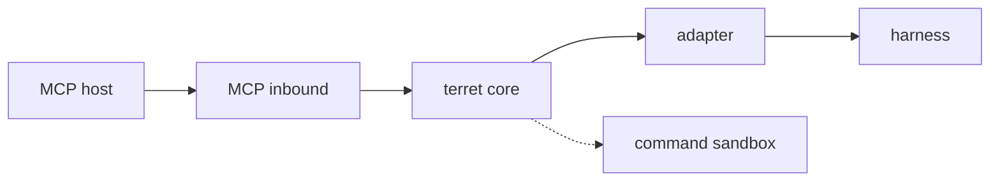

# Terret

Terret is the ring a rein passes through: an MCP server that lets coding hosts drive harnesses such as Grok Build and dsh, with a deny-by-default permission ceiling and confined commands.

The name is from the rings on a harness that the reins pass through, the way a heddle is a guide on a loom. It is not the host, and it is not the harness.

[Documentation](https://www.earlyeffect.rocks/terret/) · [CI](https://github.com/early-effect/terret/actions/workflows/ci.yml)

## Why

- Hosts speak MCP. Harnesses do not. Terret takes MCP in and talks to the harness through an adapter, so the core stays harness-agnostic.
- Sessions, a permission ceiling, streamed events, and confined commands are built in.
- Grok Build and dsh ship as adapters. The process defaults to Grok.

## Quick start

The install coordinate is the latest stable. From this repository:

```sh
./histos run app
```

That listens on `http://127.0.0.1:8080/mcp`. Point a host at that URL with the `x-terret-key` header. Key setup, the job catalog, events, the permission ceiling, and every config key are in the [docs](https://www.earlyeffect.rocks/terret/).

## How it works



## Learn more

- [Docs site](https://www.earlyeffect.rocks/terret/): attach a host, jobs, events, the permission ceiling, config, and operations
- [DESIGN.md](DESIGN.md): decisions
- [ROADMAP.md](ROADMAP.md): which phase is open
- [LICENSE](LICENSE): Apache License 2.0
